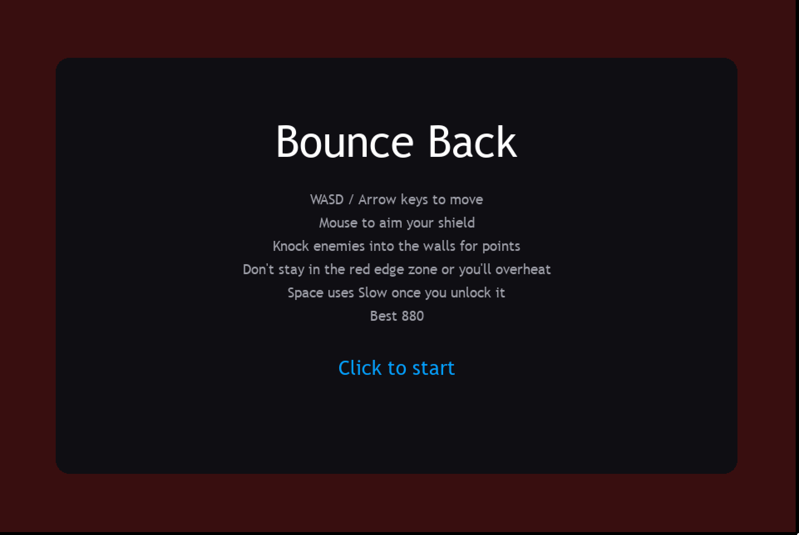

.png>)

# Bounce Back

Have fun and **bounce back**!

Python 3.13+

## About the Game
The theme of this game is "Bounce Back." We made this for the Haven Hackathon in Omaha. The main premise is that you want to *bounce* the enemies off your shield to increase your score. The enemies then *bounce back* towards you, and the cycle repeats. This game also has an upgrade system, kind of like a rougelike game! There is no winning or loosing, you just try to get a high score. This was made with Pygame and external sound assets.

## Gameplay demo


## Features
- Upgrades
- High score tracking
- Fun gameplay
- Increasing difficulty
- Keyboard and mouse input
- High performance
- Pause menu

## Prerequisites & Installation
1. Click on the green "Code" button
2. Click download zip
3. Navigate to the folder where you downloaded the zip
4. Extract the zip
5. Download Python 3.13 or higher from [python.org](https://python.org)
6. Open up the terminal
7. Cd into the project folder
8. Create a new virtual environment with `python -m venv venv`
9. Activate the virtual environment with `venv\Scripts\activate.bat`
10. Install Pygame with `pip install pygame-ce`
11. Run `python main.py`

## Controls & How to Play
`WASD` or arrow keys move the player. You use the mouse to move the shield. `Space` slows down the enemies. `Esc` pauses the game. `R` restarts if you die. You can't "win", but the goal is to get the highest score.

Upgrades:
- Shockwave: Pushes enemies away from you
- Extra Life: Gives you one extra life
- Bigger Shield: Increases the size of the shield by 5%
- Heat Resistance: Increases the duration you can spend in the hot zone
- Faster Feet: Increases your movement speed
- Slower Enemies: Slows the enemies down for longer
- Lasers: Shoots lasers in the direction of the shield every 5 seconds
- Recovery: Increases the invulnerability time after you get hit

## Project Tree
```
Bounce Back/
├── audio/
│   ├── background.mp3
│   ├── hit.mp3
│   ├── level_up.mp3
│   └── shoot.mp3
├── images/
│   └── character.png
├── entities.py
├── game.py
├── main.py
├── settings.py
├── ui.py
├── upgrades.py
├── README.md
└── LICENSE
```

## Future Improvements
- [ ] Multiplayer
- [ ] Skin Changing
- [ ] Different Weapons